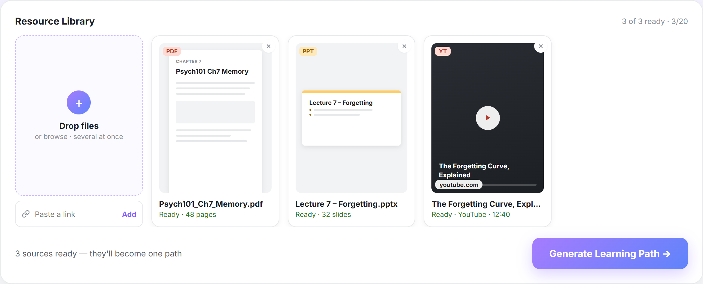
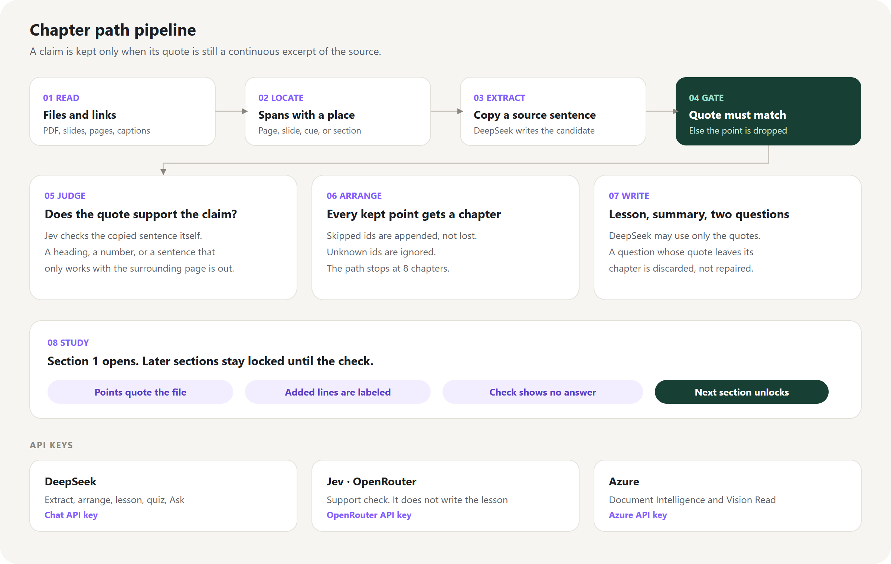
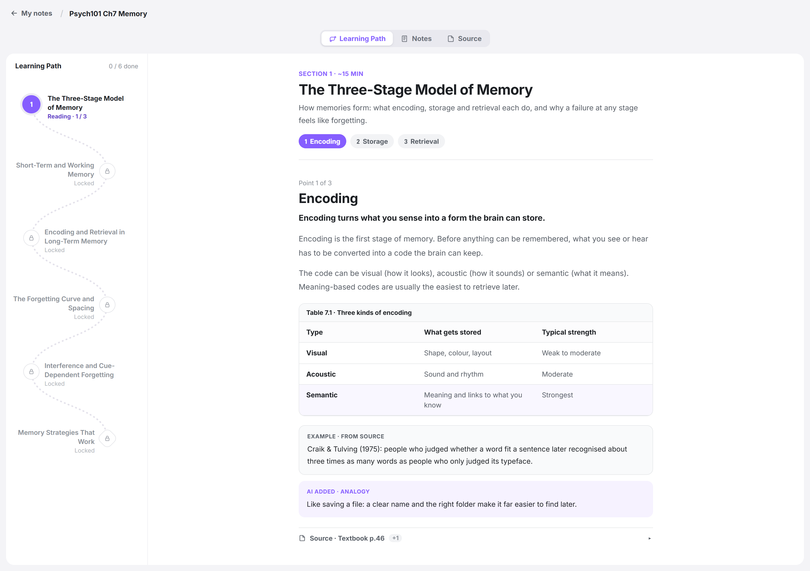
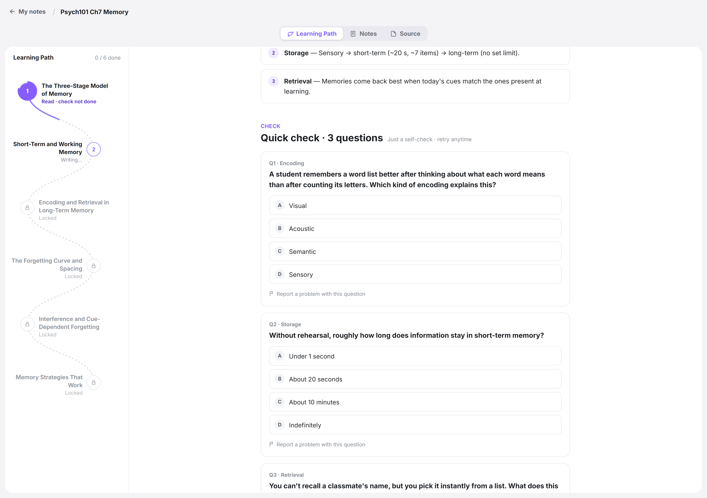

# Lynote Learning Path

**Turn notes, slides, and links into a chapter path that only teaches a sentence it can quote.**

[](https://www.python.org/)
[](https://docs.docker.com/compose/)
[](LICENSE)

[Quick start](#-quick-start) · [How it works](#-how-a-path-is-built) · [Sample course](#-sample-course) · [Try it on Lynote](https://lynote.ai/learning-path?utm_source=github&utm_medium=readme&utm_campaign=learning_path_oss&utm_content=nav) · [Discord](https://discord.gg/NzcH5DYzBj) · [中文](README.zh-CN.md)

<p align="center">
  
</p>

<p align="center"><i>Add materials to the shelf. Generate keeps a claim only when its quote is still in the file.</i></p>

---

This repository is the technical pipeline for Lynote's chapter learning path. The chain calls three providers, and each one takes its own API key:

| Provider | What it does | Key |
| --- | --- | --- |
| **DeepSeek** | Extract claims, arrange chapters, write the lesson and the quiz, answer Ask | Chat API key |
| **Jev**, through OpenRouter | Decide whether a copied sentence actually supports the claim. It does not write the lesson | OpenRouter API key |
| **Azure** | Read text from documents and images (Document Intelligence read, Vision Read) | Azure API key |

## Why this project

- **The lesson cannot outrun the file.** A concept or a question is stored only when its quote is a continuous excerpt of a source span. Anything the model adds is dropped before it reaches the course.
- **You study in order.** The next chapter stays locked, and its lesson is not sent to the browser, until the current quiz is finished.
- **The source comes back after you answer.** The explanation and the quote appear on the feedback, not on the question.
- **It runs without an account.** Docker on your machine, an OpenAI-compatible endpoint you choose, and a three-chapter sample that needs no key.

## 🚀 Quick start

```bash
git clone https://github.com/molly554/ai-tutor.git
cd ai-tutor
cp .env.example .env          # Windows: Copy-Item .env.example .env
docker compose up --build
```

Open <http://localhost:8080> and choose **Try 3 samples**.

```bash
curl http://127.0.0.1:8080/api/health
```

`{"status":"ok","llm_configured":true}` means a key was loaded. The JSON does not contain the key. `false` means the sample still runs, and your own files do not generate yet.

> No key yet? The sample course is the whole learning path with nothing to configure. To generate from your own files, put a key in `.env` and start Compose again. Or skip setup and [open the hosted path on Lynote](https://lynote.ai/learning-path?utm_source=github&utm_medium=readme&utm_campaign=learning_path_oss&utm_content=quickstart).

Local development uses the API on port 8000 and the UI on port 5173. Both shells, Windows included, are in [docs/deploy.md](docs/deploy.md). Variables are in [docs/configuration.md](docs/configuration.md).

## What you can put on the shelf

| Input | What is kept with the text |
| --- | --- |
| PDF | Page |
| Word (`.docx`), PowerPoint (`.pptx`), Excel (`.xlsx`) | Slide, sheet, or section |
| Text, Markdown, HTML, CSV | Section |
| Subtitles (`.srt`, `.vtt`) | Cue time |
| Public `http` / `https` page | Section |
| YouTube link with public captions | Caption time |
| Audio or video | Sent to your transcription endpoint, then treated as text |

Private and loopback addresses are refused before any request is sent. Uploaded binaries are parsed in memory and are not kept. The extracted text is.

## ✨ How a path is built



| Stage | What the model is asked to do | What the server keeps |
| --- | --- | --- |
| Read | — | A span plus a locator: page, slide, cue, or section |
| Extract | Copy a continuous sentence from one span | The point, only if that quote is still in the span. Fragments under 24 characters are dropped |
| Arrange | Order the point ids it was given | Every kept point, even if the model skipped one. Unknown ids are ignored. At most 8 chapters |
| Write | One lesson, one summary, two questions, each tied to a quote | A question only when its quote sits inside a point from that chapter. If the lesson call fails, the quiz is left empty instead of invented |
| Ask | Answer from the open chapter | The current lesson and its quotes. The instruction is to refuse when the answer is not in them |

The arrangement step has to account for every kept point. The write step is not allowed to add facts the quotes do not contain. Rules: [docs/pipeline.md](docs/pipeline.md). Module split: [docs/architecture.md](docs/architecture.md).

### A sentence that survives, and one that does not

From the sample note [`examples/memory/01-encoding.md`](examples/memory/01-encoding.md):

> Attention decides what enters that trace.

That sentence can become a lesson quote and a quiz quote, because it is a continuous excerpt of the note. A sentence the model might prefer — a statistic, a mechanism, a cleaner definition that was never in the file — is not stored. The same check runs on your files when a key is set.

## Learning path

<p align="center">
  
</p>

1. **The path opens on section 1.** Later sections stay locked. A section is a sequence of points.
2. **A point can quote the file.** The example is labeled as coming from the source. A line the model adds is labeled as added, not as a sentence from the file.
3. **The section ends with a check.** The choices are on the question. The answer is not.
4. **The next section follows the check.** Ask is available on the open chapter when a key is configured.

<p align="center">
  
</p>

<p align="center"><i>The check is part of the section. The question shows the choices, not the answer.</i></p>

## 📖 Sample course

[Encoding](examples/memory/01-encoding.md), [storage](examples/memory/02-storage.md), and [retrieval](examples/memory/03-retrieval.md) are three short notes. **Try 3 samples** loads a course that quotes them and does not call a model. Tests fail if a sample quote is no longer a substring of its note.

| Chapter | What the check is about |
| --- | --- |
| Encoding | Attention decides what enters the trace. Meaning beats repeating a word you do not understand |
| Storage | A short-term trace fades in seconds unless it is rehearsed. Sleep does not replace encoding |
| Retrieval | A successful retrieval strengthens the trace more than rereading. Feedback comes after the attempt |

## Open edition and Lynote

This repository is the chapter path, runnable on its own. [Lynote](https://lynote.ai/learning-path?utm_source=github&utm_medium=readme&utm_campaign=learning_path_oss&utm_content=compare) is the workspace around that path.

| | This repository | Lynote |
| --- | --- | --- |
| Where it runs | Your machine | lynote.ai |
| Model | Your OpenAI-compatible key | Included with the account |
| What can be taught | A sentence that still appears in the file | The same grounded loop, inside the full workspace |
| Accounts and billing | None. SQLite on the machine that runs the server | Accounts and learning coins |
| Materials | The shelf in the table above, with the limits below | Image reading, full-document processing, lecture transcription |
| After a chapter | The quiz unlocks the next chapter | The notes workspace beside the path |
| Setup | Docker, or the sample with an empty key | Open the page |

[Open Lynote Learning Path](https://lynote.ai/learning-path?utm_source=github&utm_medium=readme&utm_campaign=learning_path_oss&utm_content=cta)

## Ways to run it

| Way | Who it is for | How |
| --- | --- | --- |
| **Docker Compose** | A path you leave running | [Quick start](#-quick-start). Listens on port 8080 |
| **Local API + UI** | Changing the server or the shelf | [docs/deploy.md](docs/deploy.md). API on 8000, UI on 5173 |
| **Sample only** | A look at the learning path | Empty `LLM_API_KEY`, then **Try 3 samples** |
| **Hosted** | No install | [lynote.ai/learning-path](https://lynote.ai/learning-path?utm_source=github&utm_medium=readme&utm_campaign=learning_path_oss&utm_content=ways) |

## Limits in this edition

| Limit | Value |
| --- | --- |
| Sources on the shelf | 20 |
| Upload size | 20 MB |
| Text stored per source | about 200,000 characters |
| Text sent to the model for one course | about 56,000 characters, sampled from the start and from later spans when the source is longer |
| Grounded points | 40 |
| Chapters | 8 |

A longer source still produces a path. The course records that it was sampled. The hosted product reads the full document.

## Documentation

- [Deploy](docs/deploy.md) · [部署（中文）](docs/deploy.zh-CN.md) · [Configuration](docs/configuration.md)
- [Pipeline](docs/pipeline.md) · [Architecture](docs/architecture.md) · [Index](docs/README.md)
- [Contributing](CONTRIBUTING.md) · [Security](SECURITY.md) · [Changelog](CHANGELOG.md)

<details>
<summary>Repository layout</summary>

```text
web/                  Shelf and study UI (Vite)
server/app            Parse, pipeline, sample course, HTTP API
server/tests          API tests and the quote-is-in-the-source check
examples/memory       The three notes behind the sample path
docs                  Architecture, pipeline, configuration, deploy, screenshots
assets                Social preview used in the repository settings
```

Courses are stored in `data/learning-path.db` on the machine that runs the server.

</details>

## Related projects

- [Lynote Humanize Text](https://github.com/lynote-ai/humanize-text) — open pipeline that rewrites AI-drafted prose, with every step visible
- [Whiteboard AI Tutor](https://github.com/molly554/whiteboard-ai-tutor) — a whiteboard teaching protocol, and a blind review of six models
- [Lynote AI Detector](https://lynote.ai/ai-detector?utm_source=github&utm_medium=readme&utm_campaign=learning_path_oss&utm_content=related) — sentence-level scoring on the hosted product

## Contributing

Parsers, deploy fixes, the study UI, and docs are welcome. Accounts, billing, mastery, and the production prompts stay on Lynote. See [CONTRIBUTING.md](CONTRIBUTING.md).

Put a model key only in `.env`. If one was committed or pasted, revoke it at the provider and create a new one. Vulnerability reports go through a private advisory, described in [SECURITY.md](SECURITY.md).

## License

[MIT](LICENSE). Copyright 2026 Lynote.

---

⭐ **If this project helps you, give it a star** — it helps more people find it.

[Learning Path on Lynote](https://lynote.ai/learning-path?utm_source=github&utm_medium=readme&utm_campaign=learning_path_oss&utm_content=footer) · [Website](https://lynote.ai?utm_source=github&utm_medium=readme&utm_campaign=learning_path_oss&utm_content=footer) · [Discord](https://discord.gg/NzcH5DYzBj) · [X](https://x.com/lynote_ai) · [Product Hunt](https://www.producthunt.com/products/lynote-ai?launch=lynote-3)
