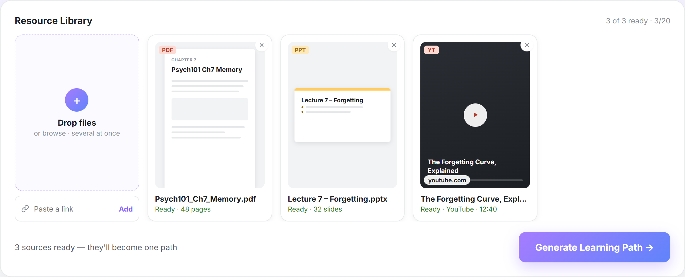
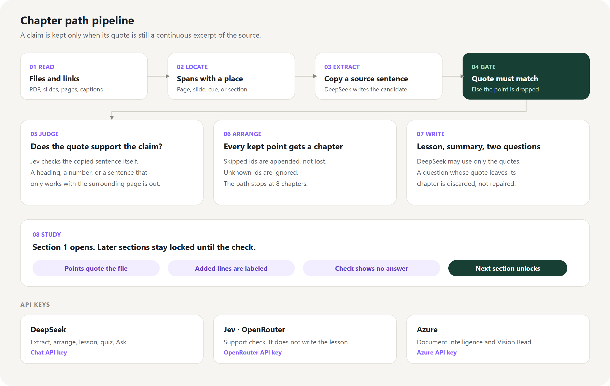
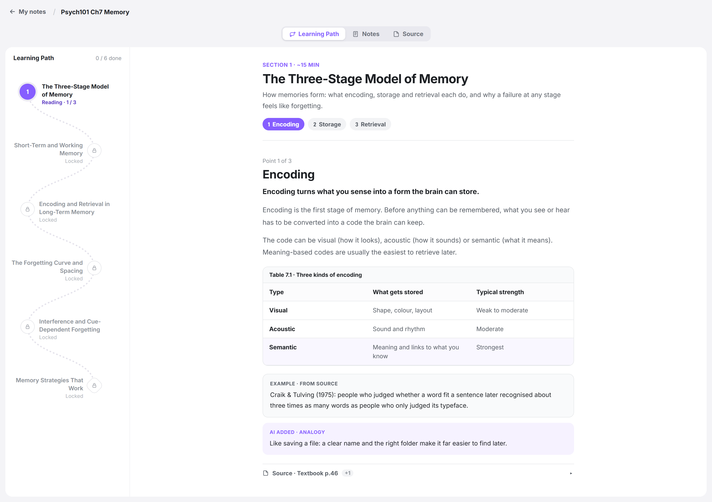
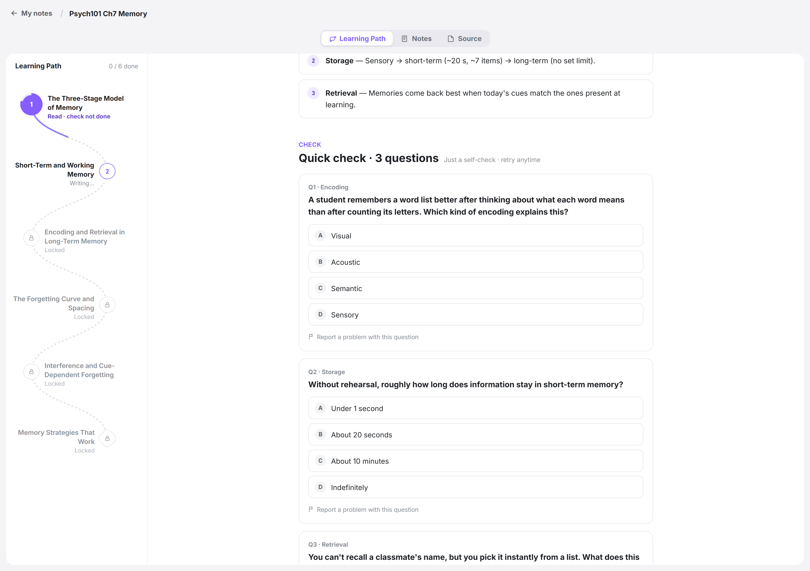

# Lynote 章节学习路径

**把笔记、幻灯片和链接排成一条章节路径。能写进讲解和题目的，只有原文里还在的那一句。**

[](https://www.python.org/)
[](https://docs.docker.com/compose/)
[](LICENSE)

[快速开始](#-快速开始) · [路径怎么生成](#-路径怎么生成) · [示例课](#-示例课) · [打开 Lynote](https://lynote.ai/learning-path?utm_source=github&utm_medium=readme&utm_campaign=learning_path_oss&utm_content=nav) · [Discord](https://discord.gg/NzcH5DYzBj) · [English](README.md)

<p align="center">
  
</p>

<p align="center"><i>材料放上书架。生成时，引文对不上原文的说法不会留下来。</i></p>

---

这是 Lynote 章节学习路径的技术链路。这条链路要接三家厂商，每家一把 API Key：

| 厂商 | 负责什么 | 密钥 |
| --- | --- | --- |
| **DeepSeek** | 抽取知识点、编排章节、写讲解和题目、回答本章提问 | Chat API Key |
| **Jev**（经 OpenRouter） | 判断摘出来的原句是否支撑这个知识点。它不写讲解 | OpenRouter API Key |
| **Azure** | 从文档和图片里读文字（Document Intelligence 的 read，Vision 的 Read） | Azure API Key |

## 这个仓库在做什么

- **讲解不能跑在文件前面。** 知识点或题目要留下来，引文必须是原文片段里的连续句子。模型补进去的事实，在写进课程之前会被丢掉。
- **按顺序学。** 上一章小测做完之前，下一章锁定，讲解也不会提前发到浏览器。
- **出处在作答之后出现。** 解释和原文出现在反馈里，不出现在还没答的题目上。
- **不用账号也能跑。** 本机 Docker、你自己选的 OpenAI 兼容接口，以及一节不需要密钥的三章示例课。

## 🚀 快速开始

```bash
git clone https://github.com/lynote-ai/ai-tutor.git
cd ai-tutor
cp .env.example .env          # Windows: Copy-Item .env.example .env
docker compose up --build
```

打开 <http://localhost:8080>，点 **Try 3 samples**。

```bash
curl http://127.0.0.1:8080/api/health
```

`{"status":"ok","llm_configured":true}` 表示密钥已读到，响应里不会出现密钥本身。`false` 时示例课仍可学习，自己的文件还不能生成。

> 还没有密钥？示例课就是完整的学习路径，不用配置。要用自己的文件生成，把密钥写进 `.env`，再重新启动 Compose。也可以跳过安装，直接[打开 Lynote 上的章节路径](https://lynote.ai/learning-path?utm_source=github&utm_medium=readme&utm_campaign=learning_path_oss&utm_content=quickstart)。

本地开发是 8000 端口的接口和 5173 端口的界面，Windows 命令也写在 [docs/deploy.zh-CN.md](docs/deploy.zh-CN.md)。变量表在 [docs/configuration.md](docs/configuration.md)。

## 书架能放什么

| 材料 | 正文旁边记下的位置 |
| --- | --- |
| PDF | 页码 |
| Word（`.docx`）、PowerPoint（`.pptx`）、Excel（`.xlsx`） | 幻灯片、工作表或小节 |
| 纯文本、Markdown、HTML、CSV | 小节 |
| 字幕（`.srt`、`.vtt`） | 时间点 |
| 公网 `http` / `https` 页面 | 小节 |
| 带公开字幕的 YouTube 链接 | 字幕时间 |
| 音频或视频 | 先走你的转写接口，再按文本处理 |

内网和本机地址会在发出请求之前被拒绝。上传的原文件只在内存里解析，不保存；抽出来的文本会留下。

## ✨ 路径怎么生成



| 阶段 | 模型被要求做什么 | 服务端留下什么 |
| --- | --- | --- |
| 读取 | — | 一段正文，加上位置：页码、幻灯片、字幕时间或小节 |
| 抽取 | 从同一个片段里抄一句连续的原文 | 这句话还在片段里，知识点才留下。短于 24 个字符的碎片会被丢掉 |
| 编排 | 给已经抽出的知识点排顺序 | 模型漏掉的知识点也会补回去。不认识的 id 会被忽略。最多 8 章 |
| 写作 | 一节讲解、一段摘要、两道题，每道题都要带引文 | 题目的引文必须落在本章某个知识点的引文里。讲解这次调用失败时，题目留空，不另编一道 |
| 提问 | 只依据当前章节回答 | 送进去的是本章讲解和引文。材料里没有的，就拒绝回答 |

编排必须覆盖每一个留下来的知识点。写讲解和出题时，不能补进引文里没有的事实。规则见 [docs/pipeline.md](docs/pipeline.md)，模块划分见 [docs/architecture.md](docs/architecture.md)。

### 留得下的句子，和留不下的句子

示例笔记 [`examples/memory/01-encoding.md`](examples/memory/01-encoding.md) 里有这一句：

> Attention decides what enters that trace.

它是笔记里的连续原文，所以可以变成讲解里的引用，也可以变成题目的出处。模型更想写的那句——一个原文里没有的数字、机制，或一句更顺的定义——不会被存进课程。配了密钥之后，你自己的文件走同一条检查。

## 学习路径

<p align="center">
  
</p>

1. **路径从第 1 节打开。** 后面的节保持锁定。一节里面是逐条知识点。
2. **知识点可以引用文件。** 例句标明来自原文。模型补上的那句会标明是补充，不算文件里的句子。
3. **这一节以小测结束。** 选项在题目上。答案不在。
4. **小测之后才是下一节。** 配置了密钥之后，可以针对当前章节提问。

<p align="center">
  
</p>

<p align="center"><i>小测是这一节的一部分。题目给出选项，不给出答案。</i></p>

## 📖 示例课

[编码](examples/memory/01-encoding.md)、[存储](examples/memory/02-storage.md)、[提取](examples/memory/03-retrieval.md) 是三篇短文。点 **Try 3 samples** 会载入引用这三篇笔记的课程，不调用模型。引文如果不再是笔记里的连续原文，测试会失败。

| 章节 | 这一章在检查什么 |
| --- | --- |
| 编码 | 注意力决定什么能进入记忆痕迹。没有意义的重复，记不住 |
| 存储 | 短期痕迹不复述，几秒内就会消退。睡眠不能代替编码 |
| 提取 | 成功提取一次，比把同一段再读一遍更加强痕迹。反馈要在尝试之后 |

## 开源版和 Lynote

这个仓库是可以单独跑起来的章节路径。[Lynote](https://lynote.ai/learning-path?utm_source=github&utm_medium=readme&utm_campaign=learning_path_oss&utm_content=compare) 是这条路径外面的学习台。

| | 这个仓库 | Lynote |
| --- | --- | --- |
| 跑在哪 | 你的电脑 | lynote.ai |
| 模型 | 你自己的 OpenAI 兼容密钥 | 跟账号走 |
| 能教什么 | 文件里仍然存在的那一句 | 同一条可回溯的路径，放在完整学习台里 |
| 账号和计费 | 没有。数据库在运行服务的这台机器上 | 账号和学习币 |
| 材料 | 上面那张书架表，以及下面的限额 | 图片阅读、长文档、讲座转写 |
| 学完一章之后 | 小测解锁下一章 | 路径旁边的笔记 |
| 准备 | Docker，或空密钥打开示例课 | 打开页面 |

[打开 Lynote 章节学习路径](https://lynote.ai/learning-path?utm_source=github&utm_medium=readme&utm_campaign=learning_path_oss&utm_content=cta)

## 运行方式

| 方式 | 适合 | 怎么做 |
| --- | --- | --- |
| **Docker Compose** | 放着持续运行 | [快速开始](#-快速开始)。端口 8080 |
| **本地接口 + 界面** | 改服务端或书架 | [docs/deploy.zh-CN.md](docs/deploy.zh-CN.md)。接口 8000，界面 5173 |
| **只看示例课** | 先走一遍学习路径 | `LLM_API_KEY` 留空，点 **Try 3 samples** |
| **主站** | 不安装 | [lynote.ai/learning-path](https://lynote.ai/learning-path?utm_source=github&utm_medium=readme&utm_campaign=learning_path_oss&utm_content=ways) |

## 这一版的限额

| 限额 | 数值 |
| --- | --- |
| 书架上的材料 | 20 份 |
| 单个上传 | 20 MB |
| 每份材料存下的文本 | 大约 20 万字符 |
| 一门课送给模型的文本 | 大约 5.6 万字符；更长的材料会从开头和后面的片段抽样 |
| 留下来的知识点 | 40 个 |
| 章节 | 8 章 |

材料更长时仍然会生成路径，课程会记下这次是抽样读的。主站读取整份文档。

## 文档

- [部署（中文）](docs/deploy.zh-CN.md) · [Deploy](docs/deploy.md) · [配置](docs/configuration.md)
- [生成规则](docs/pipeline.md) · [架构](docs/architecture.md) · [索引](docs/README.md)
- [参与贡献](CONTRIBUTING.md) · [安全](SECURITY.md) · [更新记录](CHANGELOG.md)

<details>
<summary>仓库结构</summary>

```text
web/                  书架和学习界面（Vite）
server/app            解析、生成、示例课、HTTP 接口
server/tests          接口测试，以及「引文必须在原文里」的检查
examples/memory       示例课背后的三篇笔记
docs                  架构、生成规则、配置、部署、截图
assets                仓库设置里用的社交预览图
```

课程写在运行这台服务的机器上的 `data/learning-path.db`。

</details>

## 相关项目

- [Lynote Humanize Text](https://github.com/lynote-ai/humanize-text) — 把 AI 草稿改写成自然行文的开源管线，每一步都能看见
- [Whiteboard AI Tutor](https://github.com/molly554/whiteboard-ai-tutor) — 在白板上边讲边画的协议，以及对六个模型的盲评
- [Lynote AI Detector](https://lynote.ai/ai-detector?utm_source=github&utm_medium=readme&utm_campaign=learning_path_oss&utm_content=related) — 主站上的逐句评分

## 参与贡献

欢迎解析器、部署、学习界面和文档。账号、扣费、掌握度和生产环境的提示词留在 Lynote。见 [CONTRIBUTING.md](CONTRIBUTING.md)。

密钥只放在 `.env`。一旦提交或粘贴出去，就到服务商后台作废并新建一把。漏洞请按 [SECURITY.md](SECURITY.md) 走私密报告。

## 许可证

[MIT](LICENSE)。Copyright 2026 Lynote.

---

⭐ **如果这个项目对你有用，给它一颗 Star**，更多人能找到它。

[Lynote 章节学习路径](https://lynote.ai/learning-path?utm_source=github&utm_medium=readme&utm_campaign=learning_path_oss&utm_content=footer) · [官网](https://lynote.ai?utm_source=github&utm_medium=readme&utm_campaign=learning_path_oss&utm_content=footer) · [Discord](https://discord.gg/NzcH5DYzBj) · [X](https://x.com/lynote_ai) · [Product Hunt](https://www.producthunt.com/products/lynote-ai?launch=lynote-3)
