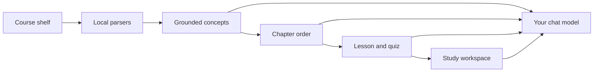

# Architecture

The open edition is one process you can run with your own model key. Deployment steps are in [deploy.md](deploy.md) ([中文](deploy.zh-CN.md)). It keeps the learning-path loop and leaves accounts, billing, and the hosted workspace on [Lynote](https://lynote.ai/learning-path?utm_source=github&utm_medium=docs&utm_campaign=learning_path_oss).

## Pieces

| Piece | Role |
| --- | --- |
| `web/` | Shelf, generation progress, and the study workspace. Vite in development, static files behind the API in Docker. |
| `server/app/parse.py` | PDF, Word, PowerPoint, Excel, text, HTML, CSV, subtitles, public web pages, and YouTube captions when a transcript is public. Audio and video go to your transcription endpoint. |
| `server/app/pipeline.py` | Extract, arrange, write. Drops any concept or question whose quote is not in the source. |
| `server/app/sample.py` | The three-note memory path. It does not call a model. |
| `data/learning-path.db` | SQLite on the machine that runs the server. Uploaded binaries are not kept; extracted text is. |

## Request flow

1. The shelf stores extracted spans for each card.
2. Generate copies those spans onto a course and starts the pipeline.
3. The study page polls `GET /api/courses/{id}` until `status` is `ready` or `failed`.
4. Chapter 1 is open. The next chapter stays locked, and its lesson is omitted from the response, until the current quiz is finished.
5. Ask sends only the current lesson and its source quotes to the model.

## What stays on Lynote

The hosted product at [lynote.ai/learning-path](https://lynote.ai/learning-path?utm_source=github&utm_medium=docs&utm_campaign=learning_path_oss) is the full study workspace: accounts, image reading, long-document processing, lecture transcription, and the shared notes around a path. This repository is the chapter path itself, so a reader can deploy it with a key they control.
